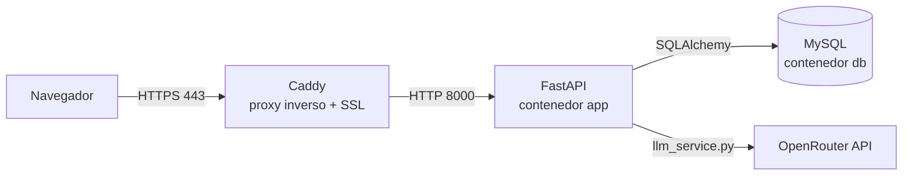
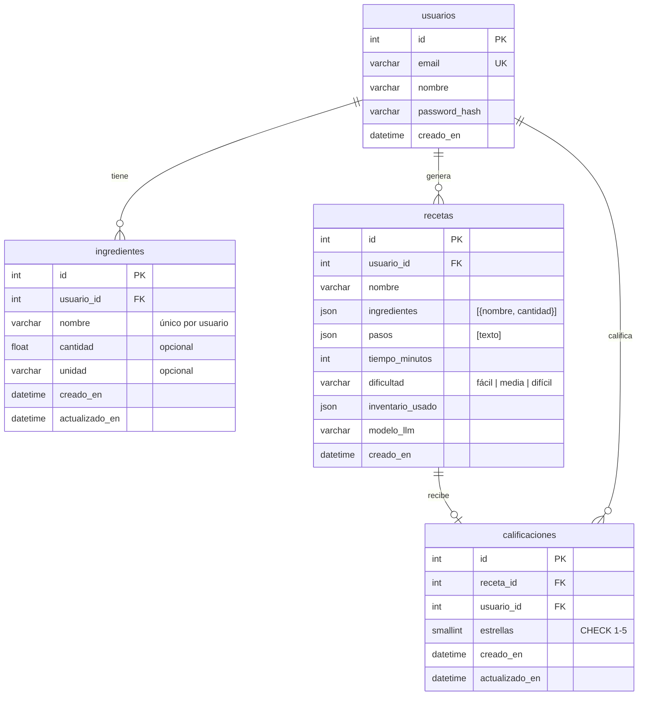

# Cocina con lo que hay: generador de recetas con IA

Aplicación web en la que cada usuario registra los ingredientes que tiene en casa y obtiene
recetas generadas por un modelo de lenguaje (LLM). Las recetas se guardan en la base de datos
y el usuario puede consultarlas, calificarlas (1 a 5 estrellas) y eliminarlas.

Proyecto final · Tecnologías Web (5916) · Universidad Simón Bolívar · 2026-2

- **Aplicación:** https://recetas.tudominio.com  ← reemplazar
- **Documentación de la API (Swagger):** https://recetas.tudominio.com/docs

## Tecnologías

| Capa | Tecnología |
|---|---|
| Back-end | Python 3.12, FastAPI, SQLAlchemy 2.0 |
| Base de datos | MySQL 8.4 |
| Autenticación | JWT (PyJWT) + contraseñas con bcrypt |
| LLM | OpenRouter (API compatible con OpenAI) mediante `httpx` |
| Front-end | Jinja2 + JavaScript y CSS sin frameworks |
| Pruebas | pytest + TestClient (SQLite en memoria y LLM simulado) |
| Despliegue | Docker, Docker Compose, Caddy (HTTPS automático con Let's Encrypt) |

## Arquitectura



Dentro de la aplicación las responsabilidades están separadas por capas:

- `routers/` reciben la petición HTTP, validan con los `schemas/` y verifican el JWT.
- `services/llm_service.py` es el **único** punto de contacto con el LLM: construye el prompt
  a partir del inventario, llama al proveedor, extrae el JSON y lo valida contra el esquema
  `RecipeLLM`. El usuario nunca escribe mensajes libres al modelo (no es un chatbot).
- `models/` define las tablas con SQLAlchemy ORM.

## Modelo de base de datos



## Endpoints

Todos los endpoints de `/api/ingredients` y `/api/recipes` requieren el header
`Authorization: Bearer <token>`.

| Método | Ruta | Descripción |
|---|---|---|
| POST | `/api/auth/register` | Registro de usuario |
| POST | `/api/auth/login` | Inicio de sesión (form: `username`=correo, `password`) → JWT |
| GET | `/api/auth/me` | Usuario autenticado |
| GET | `/api/ingredients` | Listar inventario |
| POST | `/api/ingredients` | Agregar ingrediente |
| GET | `/api/ingredients/{id}` | Ver ingrediente |
| PUT | `/api/ingredients/{id}` | Editar ingrediente |
| DELETE | `/api/ingredients/{id}` | Eliminar ingrediente |
| POST | `/api/recipes/generate` | Generar receta con el LLM a partir del inventario |
| GET | `/api/recipes` | Historial de recetas (`limit`, `offset`) |
| GET | `/api/recipes/{id}` | Ver receta |
| PUT | `/api/recipes/{id}/rating` | Calificar receta (`{"estrellas": 1-5}`) |
| DELETE | `/api/recipes/{id}` | Eliminar receta |
| GET | `/health` | Estado del servicio |

Ejemplo de receta devuelta por `POST /api/recipes/generate`:

```json
{
  "id": 7,
  "nombre": "Arroz salteado con huevo y cebolla",
  "ingredientes": [
    {"nombre": "arroz", "cantidad": "200 g"},
    {"nombre": "huevo", "cantidad": "2 unidades"}
  ],
  "pasos": ["Cocina el arroz...", "Bate los huevos...", "Saltea todo..."],
  "tiempo_minutos": 25,
  "dificultad": "fácil",
  "inventario_usado": ["arroz", "cebolla", "huevo"],
  "modelo_llm": "meta-llama/llama-3.3-70b-instruct:free",
  "calificacion": null,
  "creado_en": "2026-11-14T15:20:11"
}
```

## Estructura del proyecto

```
proyecto-recetas/
├── app/
│   ├── main.py              # Aplicación FastAPI, rutas estáticas y favicon
│   ├── config.py            # Lectura de variables de entorno
│   ├── database.py          # Motor SQLAlchemy y sesión
│   ├── security.py          # bcrypt + JWT
│   ├── models/              # Tablas: usuarios, ingredientes, recetas, calificaciones
│   ├── routers/             # auth, ingredients, recipes, web (páginas HTML)
│   ├── schemas/             # Validación Pydantic
│   ├── services/
│   │   └── llm_service.py   # Prompt, llamada al LLM y parseo del JSON
│   └── templates/           # Plantillas Jinja2
├── tests/                   # Pruebas con pytest
├── static/                  # favicon.ico, CSS y JS
├── iniciar.ps1             # Arranque local en Windows (PowerShell)
├── Caddyfile
├── docker-compose.yml
├── Dockerfile
├── .env.example
├── pytest.ini
├── README.md
└── requirements.txt
```

## Ejecución local

### Opción A: con Docker (recomendada)

```bash
cp .env.example .env          # edita los valores (JWT_SECRET, OPENROUTER_API_KEY, claves de MySQL)
docker compose up -d --build db app
```

La aplicación queda en http://localhost:8000 y la documentación en http://localhost:8000/docs.

### Opción B: sin Docker (SQLite, solo para desarrollo)

Requiere Python 3.12 o 3.13 (con 3.15 algunas librerías aún no tienen instalador para Windows).

Windows (PowerShell):

```powershell
py -V:3.13 -m venv .venv
.venv\Scripts\Activate.ps1
pip install -r requirements.txt
$env:DATABASE_URL="sqlite:///./dev.db"
$env:JWT_SECRET="una-clave-de-prueba-de-al-menos-32-caracteres"
$env:LLM_MOCK="true"
uvicorn app.main:app --reload
```

Linux / macOS:

```bash
python -m venv .venv && source .venv/bin/activate
pip install -r requirements.txt
export DATABASE_URL=sqlite:///./dev.db
export JWT_SECRET=$(openssl rand -hex 32)
export LLM_MOCK=true          # o define OPENROUTER_API_KEY para usar el LLM real
uvicorn app.main:app --reload
```

### Opción C: script de PowerShell (Windows, recomendada si no usas Docker)

Desde la carpeta del proyecto (la que contiene `requirements.txt`):

```powershell
.\iniciar.ps1
```

El script crea el entorno `.venv` la primera vez, instala las dependencias solo cuando
`requirements.txt` cambia, configura SQLite y el LLM simulado (o el real si defines
`OPENROUTER_API_KEY` antes de ejecutarlo), y muestra la dirección para el computador y para el celular
en la misma red Wi-Fi. Si PowerShell bloquea el script, ejecuta una vez
`Set-ExecutionPolicy -Scope CurrentUser RemoteSigned`.

## Pruebas

Las pruebas no necesitan MySQL ni internet: usan SQLite en memoria y un LLM simulado.

```bash
pytest                                  # en tu entorno local
docker compose exec app pytest          # dentro del contenedor
```

Cubren:

| Archivo | Qué prueba |
|---|---|
| `test_validacion.py` | Normalización y rechazo de ingredientes inválidos; rango de calificaciones |
| `test_prompt.py` | Que el prompt incluya el inventario, las porciones, las preferencias y el esquema JSON |
| `test_parser.py` | Parseo de JSON limpio, dentro de bloques ```` ``` ````, con texto alrededor, alias de campos y rechazo de respuestas inválidas |
| `test_llm_service.py` | Cliente HTTP con transporte simulado: petición enviada, reintento y errores del proveedor |
| `test_api.py` | Endpoints: registro/login, protección con JWT, CRUD de ingredientes, generar → calificar → eliminar, aislamiento entre usuarios |

## Despliegue en un VPS

1. **Servidor:** crea un VPS con Ubuntu 24.04 (DigitalOcean, Hetzner, Linode…).
2. **DNS:** en tu proveedor de dominio crea un registro `A` que apunte `recetas.tudominio.com`
   a la IP pública del VPS. Comprueba con `dig +short recetas.tudominio.com`.
3. **Firewall y Docker:**
   ```bash
   sudo apt update && sudo apt -y upgrade
   sudo ufw allow OpenSSH && sudo ufw allow 80 && sudo ufw allow 443 && sudo ufw enable
   curl -fsSL https://get.docker.com | sudo sh
   sudo usermod -aG docker $USER   # cierra sesión y vuelve a entrar
   ```
4. **Código y variables:**
   ```bash
   git clone https://github.com/<usuario>/proyecto-recetas.git
   cd proyecto-recetas
   cp .env.example .env
   nano .env   # DOMAIN, ACME_EMAIL, APP_URL, claves de MySQL, JWT_SECRET, OPENROUTER_API_KEY
   ```
5. **Levantar los servicios:**
   ```bash
   docker compose up -d --build
   docker compose ps
   docker compose logs -f caddy   # verás cuando se emita el certificado
   ```
   Caddy solicita el certificado de Let's Encrypt automáticamente la primera vez que el
   dominio resuelve a la IP del servidor, y lo renueva solo.
6. **Verificar:** abre `https://recetas.tudominio.com` (candado activo) y `/docs`.

Actualizar después de nuevos commits:

```bash
git pull && docker compose up -d --build app
```

## Decisiones técnicas

- **LLM encapsulado y con contrato.** El prompt de sistema exige un JSON con campos fijos y
  `llm_service.py` lo valida con Pydantic (`RecipeLLM`). Si el modelo responde mal, se reintenta
  una vez pidiéndole corregir el formato; si vuelve a fallar se responde `502` y no se guarda nada.
- **Robustez del parseo.** Se aceptan respuestas envueltas en bloques de código o con texto
  alrededor, alias de campos comunes (`nombre_plato`, `tiempo_estimado`) y dificultades sin tilde
  o en inglés, que se normalizan a `fácil | media | difícil`.
- **Mitigación de inyección de prompt.** Los nombres de ingredientes solo admiten letras,
  espacios y guiones; las preferencias tienen máximo 120 caracteres y el prompt indica tratarlas
  solo como preferencia culinaria.
- **Ingredientes y pasos de la receta en columnas JSON.** Una receta generada no se edita, se
  lee completa siempre, y sus ingredientes no tienen por qué coincidir con los del inventario
  (p. ej. "sal"). Guardarlos como JSON evita tablas intermedias sin beneficio. `inventario_usado`
  conserva el inventario del momento para trazabilidad.
- **Calificación en tabla propia** con restricción `CHECK (estrellas BETWEEN 1 AND 5)` y
  `UNIQUE (receta_id, usuario_id)`; `PUT` crea o actualiza (idempotente).
- **Aislamiento entre usuarios.** Cada consulta filtra por `usuario_id`; acceder a un recurso de
  otro usuario devuelve `404` para no revelar que existe.
- **Caddy en lugar de Nginx + Certbot.** Obtiene y renueva el certificado SSL sin configuración
  adicional. MySQL no publica puertos y la app solo escucha en `127.0.0.1` del servidor.
- **Secretos fuera del repositorio.** Todo se lee de `.env` (ignorado por Git); la app no arranca
  si `JWT_SECRET` tiene menos de 32 caracteres.
